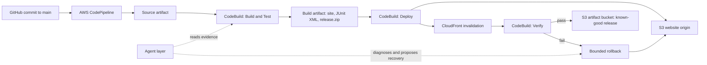
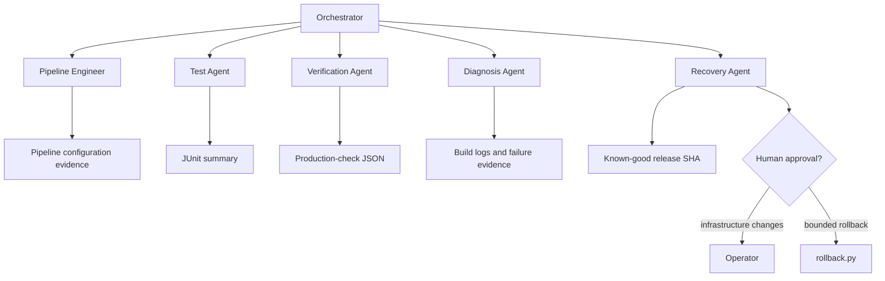

# Project 6: AI-Agent-Assisted CI/CD Pipeline

**Student:** [Your name]
**Deployed site:** `https://[SITE_DOMAIN]`
**Private repository:** `[GitHub repository URL]`

## 1. Project Overview and CI/CD Architecture

Project 6 extends the Project 5 static site with a release process that tests each change, stamps it with a release identifier, deploys it, verifies the public result, and retains an immutable copy for recovery. The goal is to prevent a failed or stale site change from silently remaining in production while retaining clear evidence for every deployment.



A GitHub push to `main` is detected by the `CodeStarSourceConnection` action in the Source stage. CodePipeline packages the selected commit as `SourceArtifact` and sends it to the build project. The Build/Test project executes pytest, writes `site/release.json` with the commit SHA and UTC timestamp, creates JUnit output, and publishes a `BuildArtifact` containing the site, scripts, and `release.zip` archive. A failed pytest command exits nonzero, so CodePipeline does not enter Deploy.

The Deploy project stores the archive in the pipeline artifact bucket, synchronizes `site/` to the S3 origin, and creates a CloudFront `/*` invalidation. The Verify project validates the public endpoint and promotes a passing archive to the known-good location. The approved AWS services are CodePipeline, CodeBuild, S3, CloudFront, IAM, and CodeStar Connections.

Configuration is account-parameterized. `pipeline/pipeline.json`, `.env.example`, and the IAM templates contain `REPLACE_*` values that must be replaced with real roles, buckets, repository, and connection ARN before deployment.

## 2. AI Agent Architecture and Integration

The agent layer uses specialized roles. Inputs and outputs use the Pydantic schemas `Task`, `Result`, and `Feedback` in `agents/base.py`; malformed input is converted to a failed result instead of controlling deployment.



| Role | Responsibility | Evidence or permitted action |
| --- | --- | --- |
| Pipeline engineer | Checks expected pipeline files. | Validates buildspec and pipeline paths. |
| Test agent | Interprets pre-deployment results. | Reads JUnit failures/errors. |
| Verification agent | Interprets production checks. | Reads the verification check map. |
| Diagnosis agent | Preserves evidence for investigation. | Uses supplied logs, JUnit data, and verification data. |
| Recovery agent | Names a known-good rollback candidate. | Proposes `python scripts/rollback.py --sha <sha>`. |
| Orchestrator | Routes typed work and records feedback. | Dispatches only to assigned roles. |

The current code is provider-agnostic and does **not** make an external LLM API call. Its agents are constrained, evidence-first role logic rather than a configured generative model. Before a report claims a model/provider, the implementation must be extended and configured with that provider's client and credentials. This is documented explicitly to avoid misrepresenting deterministic code as a model invocation.

Agents can analyze evidence and propose actions, but deterministic scripts perform testing, stamping, deployment, invalidation, verification, and rollback. `EvidenceAgent.call_tool` only invokes registered tools and requires dictionary output. `agents/approvals.py` requires a `y` response for consequential actions such as infrastructure changes. The only intended automatic recovery is restoring a previously verified immutable release.

## 3. Automated CI/CD Implementation

The pipeline definition is `pipeline/pipeline.json`; its creation command is:

```bash
aws codepipeline create-pipeline --cli-input-json file://pipeline/pipeline.json
```

The build project installs `requirements.txt`, runs tests, stamps the commit, and archives the site:

```yaml
- "mkdir -p artifacts && pytest -q --junitxml=artifacts/junit.xml"
- "python scripts/stamp_release.py --sha $CODEBUILD_RESOLVED_SOURCE_VERSION"
- "zip -rq artifacts/release.zip site"
```

`scripts/deploy.sh` runs `aws s3 sync site/ s3://$WEBSITE_BUCKET/ --delete`; `scripts/invalidate_cache.sh` then calls `aws cloudfront create-invalidation` for `/*`. This prevents a stale CloudFront cache from continuing to serve prior files.

Each release is identified by the SHA in `site/release.json`. `scripts/record_status.py` writes `deployments/<sha>.json` locally and to the artifact bucket when configured. Archives live at `releases/<sha>.zip` in the artifact bucket, never in the website origin. A release succeeds only after post-deploy verification exits successfully; only then is it promoted as known-good.

**Evidence to add after an AWS run:** CodePipeline execution screenshot, green build log with pytest output, CloudFront invalidation ID, and S3 artifact keys.

## 4. Testing, Verification, and Release Validation

| Test file | Validation |
| --- | --- |
| `test_files.py` | Required HTML, manifest, CSS, and JavaScript files exist. |
| `test_pages.py` | The primary page has a title and main element. |
| `test_links.py` | Local assets referenced by HTML exist. |
| `test_assets.py` | CSS and JavaScript assets are nonempty. |
| `test_structure.py` | Expected repository folders exist. |
| `test_release_id.py` | `release.json` has a SHA and timestamp. |

Pytest runs in the Build/Test CodeBuild phase. A nonzero result stops the pipeline before deployment, and JUnit XML supplies concrete failure evidence.

`scripts/verify_production.py` checks HTTPS reachability, HTTP-to-HTTPS redirect behavior, a valid TLS connection, `release.json` matching the expected SHA, presence of the critical “Reliable Releases” content, and a direct S3 `index.html` request returning 403. The script prints JSON and exits nonzero when a required check fails. CodeBuild logs, JUnit XML, verification JSON, the manifest, and status documents are the deployment evidence.

On verification failure, the recovery agent can identify the known-good SHA. `scripts/rollback.py` downloads its archive, synchronizes it to the origin, invalidates CloudFront, and reruns verification.

**Evidence to add after an AWS run:** passing verification JSON, a failed-test build that did not deploy, and a controlled verification failure/rollback log showing the restored release ID.

## 5. Challenges, Lessons Learned, Limitations, and References

The main design challenge was safely combining automated recovery with agent recommendations. Applying free-form recommendations to infrastructure would be unsafe and difficult to audit. This design limits mutation to deterministic scripts and restoration of an already verified artifact; non-bounded infrastructure changes require human approval.

Cache consistency is another challenge: S3 can contain new files while CloudFront serves cached old content. The deployment invalidates `/*`, while verification reads public `release.json`, so success depends on the edge-visible release rather than merely a successful S3 upload.

Current limitations are important: no external LLM provider is configured, account-specific AWS placeholders remain, production screenshots/evidence still require a real run, and the tests target the supplied static site rather than browser-level interaction flows.

### References

- AWS CodePipeline: https://docs.aws.amazon.com/codepipeline/
- AWS CodeBuild buildspec reference: https://docs.aws.amazon.com/codebuild/latest/userguide/build-spec-ref.html
- Amazon CloudFront invalidations: https://docs.aws.amazon.com/AmazonCloudFront/latest/DeveloperGuide/Invalidation.html
- pytest: https://docs.pytest.org/
- Pydantic: https://docs.pydantic.dev/

### AI-tool disclosure

AI assistance was used to scaffold code and this documentation. Any final report should identify a deployed model/provider accurately and should rely on actual configuration and execution evidence.
