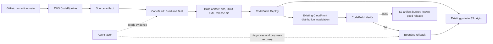
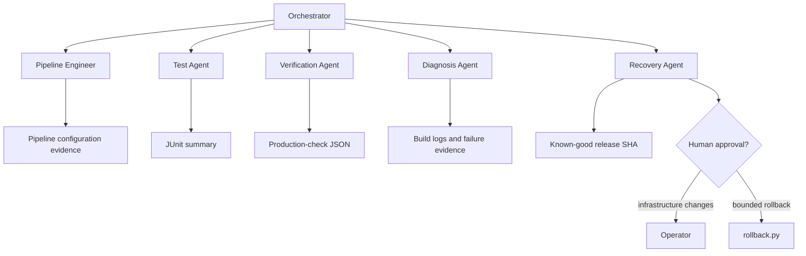

# Project 6: AI-Agent-Assisted CI/CD Pipeline

**Student:** [Your name]
**Deployed site:** `https://csce412aadiujoshi.shop`
**Project 5 repository:** `https://github.com/aadiujoshi-tamu/CSCE412-Project5`
**Project 6 repository:** `https://github.com/aadiujoshi-tamu/CSCE412-Project6`

## 1. Project Overview and CI/CD Architecture

Project 6 extends the Project 5 Northstar Cloud Collective website with a release process that tests each change, stamps it with a release identifier, deploys it, verifies the public result, and retains an immutable copy for recovery. Project 5 established the five-page responsive static website, private S3 origin, CloudFront distribution, Route 53 DNS, ACM certificate, HTTPS redirect, and four Bedrock-backed agents. Project 6 adds the CI/CD delivery layer around that already deployed architecture; it does not replace it with a new public site or a public S3 bucket.



A GitHub push to `main` is detected by the `CodeStarSourceConnection` action in the Source stage. CodePipeline packages the selected commit as `SourceArtifact` and sends it to the build project. The Build/Test project executes pytest, writes `site/release.json` with the commit SHA and UTC timestamp, creates JUnit output, and publishes a `BuildArtifact` containing the site, scripts, and `release.zip` archive. A failed pytest command exits nonzero, so CodePipeline does not enter Deploy.

The Deploy project stores the archive in the pipeline artifact bucket, synchronizes `site/` to the existing private S3 origin, and creates a CloudFront `/*` invalidation. It preserves the Project 5 Origin Access Control (OAC): public readers still reach content only through CloudFront, while a direct S3 request must remain forbidden. The Verify project validates `https://csce412aadiujoshi.shop` and promotes a passing archive to the known-good location. The approved AWS services are CodePipeline, CodeBuild, S3, CloudFront, IAM, CodeStar Connections, Route 53, ACM, and Bedrock.

Configuration is account-parameterized. `pipeline/pipeline.json`, `.env.example`, and the IAM templates contain `REPLACE_*` values that must be replaced with real roles, buckets, repository, and connection ARN before deployment.

## 2. AI Agent Architecture and Integration

Project 5 supplied four Amazon Bedrock-backed roles: Requirements, Infrastructure, Security, and Verification. It used Amazon Nova Micro (`amazon.nova-micro-v1:0`) in `us-east-1` through the Bedrock Converse API, with structured handoffs and deterministic tool results retained as the source of truth. Project 6 adds delivery-specific responsibilities: pipeline engineering, test interpretation, diagnosis, and release recovery. Inputs and outputs use the Pydantic schemas `Task`, `Result`, and `Feedback` in `agents/base.py`; malformed input is converted to a failed result instead of controlling deployment.



| Role | Responsibility | Evidence or permitted action |
| --- | --- | --- |
| Pipeline engineer | Checks expected pipeline files. | Validates buildspec and pipeline paths. |
| Test agent | Interprets pre-deployment results. | Reads JUnit failures/errors. |
| Verification agent | Interprets production checks. | Reads the verification check map. |
| Diagnosis agent | Preserves evidence for investigation. | Uses supplied logs, JUnit data, and verification data. |
| Recovery agent | Names a known-good rollback candidate. | Proposes `python scripts/rollback.py --sha <sha>`. |
| Orchestrator | Routes typed work and records feedback. | Dispatches only to assigned roles. |

The Project 5 model/provider is Amazon Bedrock with Amazon Nova Micro in `us-east-1`. The current Project 6 scaffolding is provider-agnostic and does **not yet** make an external LLM API call, so the Bedrock client and Project 5 role implementation must be carried into the CI/CD repository before the Project 6 system is described as actively Bedrock-backed. This distinction prevents the report from misrepresenting deterministic scaffolding as a model invocation.

Agents can analyze evidence and propose actions, but deterministic scripts perform testing, stamping, deployment, invalidation, verification, and rollback. `EvidenceAgent.call_tool` only invokes registered tools and requires dictionary output. `agents/approvals.py` requires a `y` response for consequential actions such as infrastructure changes. The only intended automatic recovery is restoring a previously verified immutable release.

## 3. Automated CI/CD Implementation

The pipeline definition is `pipeline/pipeline.json`; its creation command is:

```bash
aws codepipeline create-pipeline --cli-input-json file://pipeline/pipeline.json
```

The build project installs `requirements.txt`, runs tests, stamps the commit, and archives the site:

```yaml
- "mkdir -p artifacts && pytest -q --junitxml=artifacts/junit.xml"
- "python scripts/stamp_release.py --sha $CODEBUILD_RESOLVED_SOURCE_VERSION"
- "zip -rq artifacts/release.zip site"
```

`scripts/deploy.sh` runs `aws s3 sync site/ s3://$WEBSITE_BUCKET/ --delete`; `scripts/invalidate_cache.sh` then calls `aws cloudfront create-invalidation` for `/*`. This preserves the Project 5 deployment path while automating it. The target bucket remains private behind CloudFront OAC, and Route 53 continues to direct `csce412aadiujoshi.shop` to the CloudFront distribution using apex alias records. This prevents a stale CloudFront cache from continuing to serve prior files.

Each release is identified by the SHA in `site/release.json`. `scripts/record_status.py` writes `deployments/<sha>.json` locally and to the artifact bucket when configured. Archives live at `releases/<sha>.zip` in the artifact bucket, never in the website origin. A release succeeds only after post-deploy verification exits successfully; only then is it promoted as known-good.

**Evidence to add after an AWS run:** CodePipeline execution screenshot, green build log with pytest output, CloudFront invalidation ID, and S3 artifact keys.

## 4. Testing, Verification, and Release Validation

| Test file | Validation |
| --- | --- |
| `test_files.py` | Required HTML, manifest, CSS, and JavaScript files exist. When the Project 5 site is imported, this must include `index.html`, `services.html`, `approach.html`, `team.html`, `contact.html`, and `404.html`. |
| `test_pages.py` | The primary page has a title and main element; the completed suite should validate all five Project 5 pages. |
| `test_links.py` | Local assets referenced by HTML exist. |
| `test_assets.py` | CSS and JavaScript assets are nonempty. |
| `test_structure.py` | Expected repository folders exist. |
| `test_release_id.py` | `release.json` has a SHA and timestamp. |

Pytest runs in the Build/Test CodeBuild phase. A nonzero result stops the pipeline before deployment, and JUnit XML supplies concrete failure evidence.

`scripts/verify_production.py` checks HTTPS reachability, HTTP-to-HTTPS redirect behavior, a valid TLS connection, `release.json` matching the expected SHA, critical page content, and a direct S3 `index.html` request returning 403. For the Project 5 production site, its content check should be updated from the scaffold text to “Northstar Cloud Collective,” and it should verify the five primary routes plus the custom 404 behavior. The script prints JSON and exits nonzero when a required check fails. CodeBuild logs, JUnit XML, verification JSON, the manifest, and status documents are the deployment evidence.

On verification failure, the recovery agent can identify the known-good SHA. `scripts/rollback.py` downloads its archive, synchronizes it to the origin, invalidates CloudFront, and reruns verification.

**Evidence to add after an AWS run:** passing verification JSON, a failed-test build that did not deploy, and a controlled verification failure/rollback log showing the restored release ID.

## 5. Challenges, Lessons Learned, Limitations, and References

The main design challenge was safely combining the Project 5 Bedrock-agent workflow with automatic delivery. Applying free-form recommendations to infrastructure would be unsafe and difficult to audit. This design limits mutation to deterministic scripts and restoration of an already verified artifact; non-bounded infrastructure changes require human approval.

Cache consistency is another challenge: S3 can contain new files while CloudFront serves cached old content. The deployment invalidates `/*`, while verification reads public `release.json`, so success depends on the edge-visible release rather than merely a successful S3 upload.

Current limitations are important: the Project 6 scaffold has not yet imported the Project 5 Bedrock client, agent code, or full five-page site; account-specific pipeline placeholders remain; production screenshots/evidence still require a real run; and the current tests must be expanded for the Project 5 category filter, contact-form validation, five primary pages, and custom 404 behavior.

### References

- AWS CodePipeline: https://docs.aws.amazon.com/codepipeline/
- AWS CodeBuild buildspec reference: https://docs.aws.amazon.com/codebuild/latest/userguide/build-spec-ref.html
- Amazon CloudFront invalidations: https://docs.aws.amazon.com/AmazonCloudFront/latest/DeveloperGuide/Invalidation.html
- Amazon Bedrock Converse API: https://docs.aws.amazon.com/bedrock/latest/APIReference/API_runtime_Converse.html
- pytest: https://docs.pytest.org/
- Pydantic: https://docs.pydantic.dev/

### AI-tool disclosure

AI assistance was used to scaffold code and this documentation. Any final report should identify a deployed model/provider accurately and should rely on actual configuration and execution evidence.
